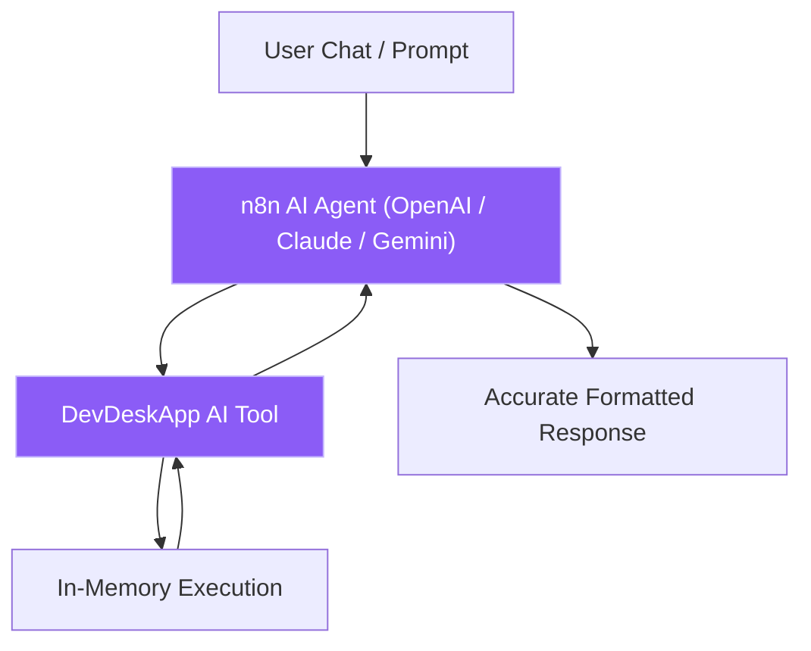

# n8n Community Node: DevDeskApp

`n8n-nodes-devdeskapp` is an official community node for [n8n](https://n8n.io) that brings high-performance, zero-latency developer utilities, formatters, and financial calculation engines directly into your automation pipelines.

  Version <NodeVersion /> (Latest)
  Official n8n Template #21017
  MIT Open Source

---

## Why Use DevDeskApp in n8n?

Automation developers, DevOps teams, and HR operations frequently encounter repetitive data transformation bottlenecks:
- **Sanitizing raw webhook payloads** into clean, formatted JSON.
- **Generating cryptographic hashes (SHA-256 / MD5)** to verify webhook signatures or track payload tamper-evidence.
- **Hashing passwords securely using Bcrypt** before storing them in PostgreSQL or Supabase.
- **Calculating Indian payroll and take-home salary** from gross CTC for recruitment and onboarding flows.
- **Generating RFC 4122 UUID v4 trace IDs** for distributed request tracing.
- **Cleaning candidate and project titles into URL-safe slugs**.

### Before DevDeskApp vs. With DevDeskApp

| Dimension | Custom Code Nodes / Cloud APIs | With `n8n-nodes-devdeskapp` |
| :--- | :--- | :--- |
| **Execution Latency** | 150ms – 500ms network round-trip | **< 1ms in-memory native CPU** |
| **Data Privacy** | Sensitive payloads leave container to 3rd-party APIs | **100% Zero-leak local memory** |
| **Maintenance** | Brittle JavaScript snippets prone to syntax breakage | **Strictly typed visual UI with schema validation** |
| **Error Tracing** | Unclear stack traces in raw code | **Native n8n `pairedItem` data lineage** |
| **AI Agent Support** | Requires custom prompt function calling setup | **Native `usableAsTool: true` for n8n AI Agents** |

---

## 📸 Visual Workspace Overview

### Visual Community Node Settings
Installed directly from n8n's community registry without complex command-line builds:

  

Figure 1: Installing and managing n8n-nodes-devdeskapp inside the n8n Settings UI.

### Interactive Parameter Drawer
Easily switch between resources and operations using intuitive dropdowns and dynamic expression fields:

  

Figure 2: Configuring operations, parameters, and input expressions in the n8n Node drawer.

---

## 🛠️ Complete Operations Matrix

| Category | Operation | Description |
| :--- | :--- | :--- |
| **JSON Utility** | `Prettify` | Formats raw minified JSON into human-readable formatted string with custom 2, 4, or tab indents. |
| **JSON Utility** | `Minify` | Compacts large JSON objects by stripping non-semantic whitespace for efficient network transport. |
| **JSON Utility** | `Validate` | Validates syntax integrity, returning clear line/character error diagnostics. |
| **Crypto & Hash** | `Hash` | Computes standard cryptographic digests (`SHA-256`, `MD5`, `SHA-512`) from text. |
| **Crypto & Hash** | `UUID Generator` | Generates collision-resistant RFC 4122 compliant UUID Version 4 tokens. |
| **Crypto & Hash** | `Bcrypt Hash` | One-way password hashing with configurable salt rounds (default: 10). |
| **Crypto & Hash** | `Bcrypt Compare` | Constant-time password verification against an existing Bcrypt hash. |
| **Text & String** | `Slugify` | Converts names, titles, and strings into URL-safe slugs with customizable delimiters. |
| **Text & String** | `Regex Matcher` | Tests string against regular expression patterns with flags (`g`, `i`, `m`). |
| **HR & Payroll** | `CTC Calculator` | Computes monthly gross, take-home salary, Employee/Employer PF, PT, and tax breakdown. |

---

## 🤖 AI Agent Tool Compatibility

The DevDeskApp node exposes `usableAsTool: true`. When you connect DevDeskApp to an **n8n AI Agent** node, the LLM can autonomously choose to format JSON, hash passwords, or calculate compensation without requiring custom tool code.

---

## 📖 Next Steps

- [Step-by-Step Installation Guide &rarr;](/n8n/installation)
- [Complete Operations Reference with Code Examples &rarr;](/n8n/operations)
- [Official Workflow Templates &rarr;](/n8n/workflow-templates)
