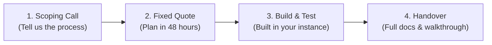

# 💼 Custom n8n Workflow Automation & Consulting Services

> **Built by the creators of [`n8n-nodes-devdeskapp`](https://www.npmjs.com/package/n8n-nodes-devdeskapp)** — the community node powering deterministic in-memory formatting, cryptography, payroll math, and AI agent function calling.

Need robust, error-tolerant workflows for your company? We design, build, test, and maintain production-grade n8n automations tailored to your exact tech stack.

  

    

      <h3 style="margin: 0; font-size: 1.25rem; font-weight: 700; color: var(--vp-c-text-1);">🚀 Ready to automate your workflow?</h3>
      
Get a fixed-price quote and workflow architecture plan within 2 business days.

    

    <a href="https://www.devdeskapp.com/n8n-automation-services" target="_blank" rel="noopener noreferrer" style="display: inline-flex; align-items: center; gap: 0.5rem; padding: 0.75rem 1.5rem; background: #6366f1; color: #ffffff; font-weight: 700; border-radius: 0.75rem; text-decoration: none;">
      Request a Fixed Quote
      &rarr;
    </a>
  

---

## 🛠️ What We Build for Teams & Enterprises

### 1. 🛒 E-Commerce & Inventory Automation
- Real-time order reconciliation, COGS calculation, and break-even ROAS reports.
- Multi-store inventory sync (Shopify, WooCommerce, Amazon, Google Merchant Center).
- Automated abandoned cart recovery via WhatsApp Cloud API and email.

### 2. 📊 Marketing, Meta CAPI & Google Ads Attribution
- Privacy-safe server-side conversion tracking for Meta Conversions API (CAPI) and Google Enhanced Conversions.
- Timing-safe SHA-256 PII hashing (email, telephone, postal code) ensuring 100% GDPR/CCPA compliance.
- Inbound lead routing and deduplication across Typeform, Webflow, HubSpot, and PostgreSQL.

### 3. 🛡️ Financial Webhooks, Fraud & Billing Security
- Stripe, PayPal, and Razorpay webhook validation with HMAC cryptographic checksums.
- Idempotency deduplication guarantees so retry bursts never charge customers twice.
- Automated invoice generation, GST tax withholding, and instant Slack notifications.

### 4. 🤖 Autonomous AI Agents & LangChain Tool Calling
- AI customer support and triage agents equipped with memory, guardrails, and deterministic tool nodes.
- Markdown code fence sanitizers and strict JSON schema validators for OpenAI GPT-4o, Claude 3.5, and Gemini outputs.
- Automated Jira/Linear task generation from meeting transcripts.

### 5. 🧩 Custom Private n8n Node Development
- Need to integrate an internal proprietary API into n8n? We develop and package custom TypeScript community nodes for your private npm registry or self-hosted deployment.
- High-performance deterministic code with zero memory leaks and complete test suites.

---

## 🔒 Why Choose the DevDeskApp Engineering Team?

| Guarantee | How It Works |
|---|---|
| **Zero Credential Sharing** | Workflows are built directly inside your own n8n instance (Cloud or Self-Hosted) or imported via secure JSON blueprints. We never store your database or API secrets. |
| **Fixed-Price Quotes** | Every project receives an upfront fixed-scope estimate. No unexpected hourly bills or runaway consulting costs. |
| **Edge-Case Tested** | We run automated test harnesses with synthetic and edge-case fixtures to ensure retries, network dropouts, and timeouts fail gracefully. |
| **Comprehensive Handover** | Every automation includes complete visual workflow diagrams, field documentation, and an async video walkthrough for your internal team. |

---

## 📋 How We Work: 4 Simple Steps

1. **Tell Us The Process:** Describe the manual bottleneck, the services involved, and your expected outcome.
2. **Architecture & Fixed Quote:** Within 48 hours, we provide an architectural node diagram, prerequisites, and a fixed price.
3. **Build & Test:** We implement the pipeline with complete error branches, retry limits, and credential validation.
4. **Handover & Walkthrough:** You receive ownership of the workflow, plain-English documentation, and team training.

---

  <h3 style="margin: 0 0 0.5rem 0; font-size: 1.35rem; font-weight: 700;">Ready to discuss your automation pipeline?</h3>
  

    Whether you need an automated lead router, an AI agent, or an enterprise webhook pipeline, let's build it together.
  

  

    <a href="https://www.devdeskapp.com/n8n-automation-services" target="_blank" rel="noopener noreferrer" style="display: inline-flex; align-items: center; gap: 0.5rem; padding: 0.75rem 1.75rem; background: #6366f1; color: #ffffff; font-weight: 700; border-radius: 0.75rem; text-decoration: none;">
      Submit Project Request
      &rarr;
    </a>
    <a href="mailto:support@devdeskapp.com?subject=Custom%20n8n%20Automation%20Inquiry" style="display: inline-flex; align-items: center; gap: 0.5rem; padding: 0.75rem 1.75rem; background: transparent; border: 1px solid var(--vp-c-border); color: var(--vp-c-text-1); font-weight: 700; border-radius: 0.75rem; text-decoration: none;">
      Email: support@devdeskapp.com
    </a>
  

