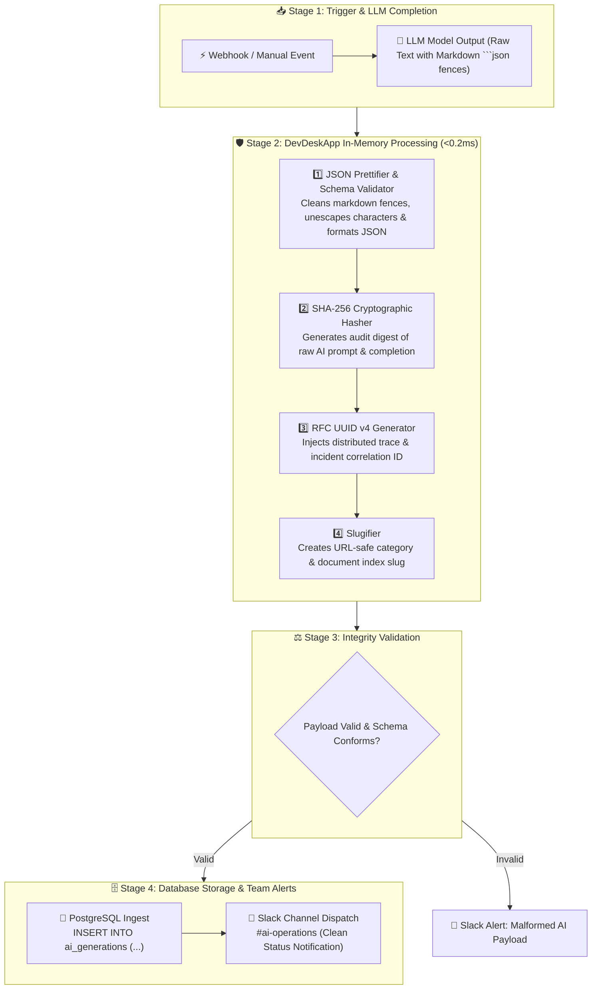

# 🤖 Template #21593: Sanitize & Ingest AI LLM JSON into Postgres with DevDeskApp and Slack

<div style="margin: 1rem 0; display: flex; gap: 8px; flex-wrap: wrap; align-items: center;">
  <span class="badge-live">Published on n8n.io Creator Portal</span>
  <span class="badge-live" style="background: rgba(99, 102, 241, 0.12); color: #6366f1; border-color: rgba(99, 102, 241, 0.3);">Template ID: 21593</span>
</div>

🔗 **Direct n8n Template Link:**  
[https://n8n.io/workflows/21593-sanitize-and-ingest-ai-llm-json-into-postgres-with-devdeskapp-and-slack/)

<div class="doc-image">
  
</div>
<div class="doc-caption">Figure 1: Full AI LLM JSON ingestion and sanitation pipeline in n8n.</div>

---

## 🎯 Overview & Use Cases

Large Language Models (OpenAI GPT-4, Anthropic Claude, Google Gemini, Ollama, DeepSeek) are increasingly used to generate structured JSON payloads. However, in production pipelines, LLMs introduce several critical failure modes:

1. **Markdown Code Fence Pollution:** LLMs frequently wrap JSON output in markdown backticks (e.g., ```` ```json ... ``` ````) or include conversational preambles/postambles that break downstream native JSON parsers and SQL statements.
2. **Missing Distributed Correlation:** Without an RFC 4122 UUID injected at ingestion, tracking multi-agent or asynchronous AI calls across PostgreSQL and Slack is impossible.
3. **Data Integrity & Non-Repudiation:** Generative AI responses must be cryptographically hashed (SHA-256) to ensure tamper-proof audit trails for compliance and billing validation.
4. **Unformatted Slugs:** AI categories, topics, or customer usernames need URL-safe normalization before database indexing.

**Template #21593** acts as an enterprise-grade ingestion gateway. It intercepts raw AI completions, strips markdown fences, validates and prettifies JSON, calculates cryptographic SHA-256 digests and UUID v4 trace tokens, normalizes taxonomy slugs, and inserts clean structured records directly into PostgreSQL with automated Slack alerts.

---

## 📸 Workflow Architecture

### Pipeline Sequence



---

## ⚙️ Key Operations Used

| Operation | DevDeskApp Function | Purpose |
| :--- | :--- | :--- |
| **JSON Prettifier** | `formatJson` | Strips outer markdown wrappers (` ```json `), validates syntax, and produces normalized JSON. |
| **SHA-256 Digest** | `generateHash` | Timing-safe cryptographic SHA-256 hash guaranteeing payload integrity and non-repudiation. |
| **UUID v4 Trace** | `generateUuid` | Injects an RFC 4122 v4 unique ID to link database rows with audit logs and Slack alerts. |
| **Slugifier** | `slugify` | Transforms model topics and category names into normalized lowercase URL-friendly strings. |

---

## ⚡ Real-Time Execution Result

### Sample Input (Raw LLM Output)

```text
Here is your generated analysis:
```json
{
  "topic": "Automated Cloud FinOps 2026",
  "confidenceScore": 0.984,
  "recommendations": [
    "Scale idle compute nodes during off-peak hours",
    "Consolidate external API gateways to local memory tools"
  ],
  "author": "Autonomous Agent Alpha"
}
```
Please let me know if you need any adjustments!
```

### Clean Normalized Output Sample

```json
{
  "traceId": "c479e390-d8fa-4e78-9844-46b0a1a09d31",
  "payloadHash": "7f83b1657ff1fc53b92dc18148a1d65dfc2d4b1fa3d677284addd200126d9069",
  "topicSlug": "automated-cloud-finops-2026",
  "parsedData": {
    "topic": "Automated Cloud FinOps 2026",
    "confidenceScore": 0.984,
    "recommendations": [
      "Scale idle compute nodes during off-peak hours",
      "Consolidate external API gateways to local memory tools"
    ],
    "author": "Autonomous Agent Alpha"
  },
  "ingestedAt": "2026-11-04T00:30:00.000Z",
  "dbStatus": "SUCCESS"
}
```

---

## 📥 How to Import into Your n8n Instance

1. Open the [n8n Creator Portal page](https://n8n.io/workflows/21593-sanitize-and-ingest-ai-llm-json-into-postgres-with-devdeskapp-and-slack/) and copy the template JSON or click **"Use workflow"**.
2. In your n8n workspace, navigate to **Workflows → New Workflow**.
3. Press **`Ctrl + V`** (or **`Cmd + V`** on macOS) inside the workflow canvas.
4. Configure your **PostgreSQL** credentials and **Slack** webhook URL.
5. Save and trigger the workflow!
