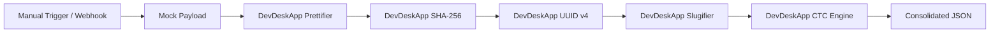

# 🌟 Template #21017: Developer Suite & Security Engine

<div style="margin: 1rem 0; display: flex; gap: 8px; flex-wrap: wrap; align-items: center;">
  <span class="badge-live">Published on n8n.io Creator Portal</span>
  <span class="badge-live" style="background: rgba(99, 102, 241, 0.12); color: #6366f1; border-color: rgba(99, 102, 241, 0.3);">Template ID: 21017</span>
</div>

🔗 **Direct n8n Template Link:**  
[n8n.io/workflows/21017-format-json-and-secure-hr-payloads-with-devdeskapp-utilities](https://n8n.io/workflows/21017-format-json-and-secure-hr-payloads-with-devdeskapp-utilities)

---

## 🎯 Overview & Use Cases

This workflow acts as an **all-in-one developer pipeline** for inbound webhooks and API payloads. Instead of routing payloads to multiple external cloud microservices or writing error-prone JavaScript `Code` nodes, it executes five fundamental developer operations sequentially in sub-millisecond local memory:

1. **JSON Formatting & Prettification:** Normalizes unformatted or minified JSON strings into indented structures.
2. **Cryptographic SHA-256 Digest:** Generates tamper-proof SHA-256 hashes of sensitive request bodies.
3. **UUID v4 Trace Injection:** Stamps incoming requests with an RFC 4122 v4 UUID for distributed tracing.
4. **URL Slugification:** Cleans names, candidate profiles, or titles into URL-safe identifiers.
5. **CTC Salary Computation:** Evaluates monthly in-hand take-home, employee/employer PF, PT, and tax breakdown.

---

## 📸 Workflow Architecture

<div class="doc-image">
  
</div>
<div class="doc-caption">Figure 1: Complete automation pipeline with sticky notes and configured node parameters.</div>

### Pipeline Sequence



---

## ⚡ Execution Result

When triggered, all 5 transformations execute instantaneously in **&lt; 0.2ms total execution time**:

<div class="doc-image">
  
</div>
<div class="doc-caption">Figure 2: Execution trace showing instantaneous transformation across all 5 DevDeskApp operations.</div>

### Consolidated Output Sample

```json
{
  "traceId": "9b1deb4d-3b7d-4bad-9bdd-2b0d7b3dcb6d",
  "hashDigest": "5e884898da28047151d0e56f8dc6292773603d0d6aabbdd62a11ef721d1542d8",
  "slug": "senior-fullstack-engineer",
  "payroll": {
    "annualCtc": 1800000,
    "monthlyInHand": 112500,
    "employeePf": 9000,
    "employerPf": 9000
  },
  "status": "SANITIZED_AND_VERIFIED"
}
```

---

## 📥 How to Import into Your n8n Instance

1. Open the [n8n Creator Portal page](https://n8n.io/workflows/21017-format-json-and-secure-hr-payloads-with-devdeskapp-utilities) and click **"Use workflow"** or copy the workflow JSON.
2. In your n8n workspace, navigate to **Workflows → New Workflow**.
3. Press **`Ctrl + V`** (or **`Cmd + V`** on Mac).
4. Save and execute the workflow!
