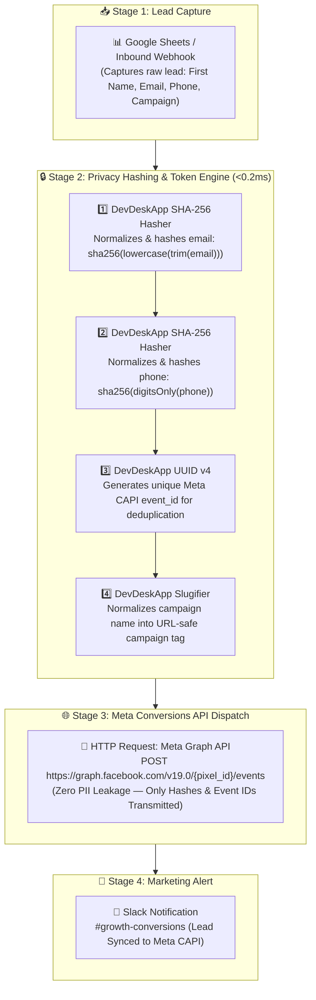

# 📊 Template #21595: Hash and Sync Leads to Meta CAPI with DevDeskApp, Google Sheets, and Slack

<div style="margin: 1rem 0; display: flex; gap: 8px; flex-wrap: wrap; align-items: center;">
  <span class="badge-live">Published on n8n.io Creator Portal</span>
  <span class="badge-live" style="background: rgba(168, 85, 247, 0.12); color: #a855f7; border-color: rgba(168, 85, 247, 0.3);">Template ID: 21595</span>
</div>

🔗 **Direct n8n Template Link:**  
[https://n8n.io/workflows/21595-hash-and-sync-leads-to-meta-capi-with-devdeskapp-google-sheets-and-slack/)

<div class="doc-image">
  
</div>
<div class="doc-caption">Figure 1: Privacy-compliant Meta Conversions API (CAPI) lead hashing and syncing pipeline in n8n.</div>

---

## 🎯 Overview & Use Cases

Privacy standards (GDPR, CCPA, Apple App Tracking Transparency) have made browser-side pixel tracking unreliable. Performance marketing teams rely heavily on server-side tracking via the **Meta Conversions API (CAPI)**.

However, implementing Meta CAPI presents strict technical hurdles:
1. **Mandatory SHA-256 PII Hashing:** Meta strictly rejects raw personal data. Emails and phone numbers must be trimmed, lowercased, and converted into lowercase hex **SHA-256** digests before transmission.
2. **Event Deduplication:** Every conversion event requires a deterministic `event_id` (RFC 4122 UUID v4) shared between pixel and server events to prevent double counting.
3. **Data Leakage Risks:** Using third-party hosted cloud hashing webhooks risks exposing unhashed customer personal identifiable information (PII).

**Template #21595** provides an end-to-end, zero-leak lead sync pipeline:
- Ingests inbound leads from **Google Sheets**, Typeform, or landing page webhooks.
- Performs timing-safe **SHA-256 hashing** on email addresses and phone numbers in local memory.
- Injects unique **UUID v4 deduplication event tokens** and formats campaign attribution slugs.
- Dispatches privacy-safe payloads to the **Meta Graph API** (`/v19.0/{pixel_id}/events`) and confirms sync status in **Slack**.

---

## 📸 Workflow Architecture

### Pipeline Sequence



---

## ⚙️ Key Operations Used

| Operation | DevDeskApp Function | Purpose |
| :--- | :--- | :--- |
| **SHA-256 Digest** | `generateHash` | Hashes sensitive customer email and phone numbers per Meta's strict privacy specifications. |
| **UUID v4** | `generateUuid` | Creates an RFC 4122 v4 unique `event_id` to ensure accurate conversion deduplication across ad accounts. |
| **Slugifier** | `slugify` | Normalizes marketing campaign titles into standardized attribution tags. |

---

## ⚡ Execution Output Sample

### Meta CAPI Normalized Payload

```json
{
  "data": [
    {
      "event_name": "Lead",
      "event_time": 1730680200,
      "event_id": "9b1deb4d-3b7d-4bad-9bdd-2b0d7b3dcb6d",
      "action_source": "system_generated",
      "user_data": {
        "em": [
          "f660ab912ec121d1b1e928a0bb4bc61b15f5ad44d5efdc4e1c92a25e99b8e44a"
        ],
        "ph": [
          "a0c598b9a2c38d7210e73686888ef39f993d04cfbdfd8a8b27dd333333e69efc"
        ]
      },
      "custom_data": {
        "campaign_slug": "q4-enterprise-cloud-migration",
        "currency": "USD",
        "value": 150.00
      }
    }
  ]
}
```

---

## 📥 How to Import into Your n8n Instance

1. Open the [n8n Creator Portal page](https://n8n.io/workflows/21595-hash-and-sync-leads-to-meta-capi-with-devdeskapp-google-sheets-and-slack/) and copy the template JSON or click **"Use workflow"**.
2. In your n8n workspace, navigate to **Workflows → New Workflow**.
3. Press **`Ctrl + V`** (or **`Cmd + V`** on macOS) to paste the blueprint.
4. Add your **Meta Pixel ID**, **System User Access Token**, and **Google Sheets** credentials.
5. Save and activate the workflow for instant, zero-leak conversion tracking!
