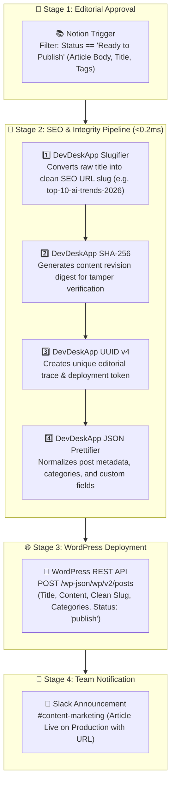

# 📝 Template #21596: Publish SEO-Safe Notion Blog Posts to WordPress with DevDeskApp and Slack

<div style="margin: 1rem 0; display: flex; gap: 8px; flex-wrap: wrap; align-items: center;">
  <span class="badge-live">Published on n8n.io Creator Portal</span>
  <span class="badge-live" style="background: rgba(236, 72, 153, 0.12); color: #ec4899; border-color: rgba(236, 72, 153, 0.3);">Template ID: 21596</span>
</div>

🔗 **Direct n8n Template Link:**  
[https://n8n.io/workflows/21596-publish-seo-safe-notion-blog-posts-to-wordpress-with-devdeskapp-and-slack/)

<div class="doc-image">
  
</div>
<div class="doc-caption">Figure 1: Automated Notion to WordPress SEO publishing pipeline with DevDeskApp and Slack.</div>

---

## 🎯 Overview & Use Cases

Modern content marketing teams write articles and manage editorial calendars in **Notion**, but publish production blogs to **WordPress**. Manual copy-pasting introduces several SEO and operational defects:

1. **Broken or Ugly URL Slugs:** Editorial titles like *"Top 10 High-Growth AI Automation Trends in 2026! (Complete Guide)"* often result in cluttered URLs with special characters and uppercase letters, damaging search rankings.
2. **Plagiarism & Content Drift:** Without deterministic cryptographic hashes, verifying if an article has been updated or tampered with between drafting and live deployment is difficult.
3. **Taxonomy & Metadata Formatting Errors:** Unformatted tag and category JSON arrays fail WordPress REST API validation.

**Template #21596** automates the entire editorial-to-production lifecycle:
- Triggers when an article status changes to **"Ready to Publish"** in Notion.
- Uses **DevDeskApp Slugifier** to generate canonical, clean, keyword-rich SEO permalinks.
- Computes **SHA-256 content verification hashes** to establish an immutable audit digest.
- Injects a **UUID v4 publishing trace ID** and formats taxonomy metadata with the **JSON Prettifier**.
- Creates or updates the post via the **WordPress REST API** and pings your marketing channel on **Slack** with the live article link.

---

## 📸 Workflow Architecture

### Pipeline Sequence



---

## ⚙️ Key Operations Used

| Operation | DevDeskApp Function | Purpose |
| :--- | :--- | :--- |
| **Slugifier** | `slugify` | Generates lowercased, hyphen-separated canonical SEO permalinks stripped of special characters. |
| **SHA-256 Digest** | `generateHash` | Creates an immutable cryptographic hash of the article body to detect content drift across revisions. |
| **UUID v4** | `generateUuid` | Injects an RFC 4122 v4 unique deployment token for cross-platform audit logs. |
| **JSON Prettifier** | `formatJson` | Validates and prettifies metadata, schema tags, and WordPress custom field payloads. |

---

## ⚡ Execution Result Sample

### Sample Published Payload

```json
{
  "postId": 4821,
  "publicationToken": "7b2e3f41-a189-4d62-8173-90d5bc84112e",
  "contentDigestSha256": "3e23e8160039594a33894f6564e1b1348bbd7a0088d42c4acb73eeaed59c009d",
  "seoPermalink": "https://blog.devdeskapp.com/top-10-ai-trends-2026",
  "slug": "top-10-ai-trends-2026",
  "title": "Top 10 High-Growth AI Automation Trends in 2026",
  "status": "PUBLISHED_LIVE",
  "notionPageId": "d98124b1-8729-411a-8219-98012bb14781"
}
```

---

## 📥 How to Import into Your n8n Instance

1. Open the [n8n Creator Portal page](https://n8n.io/workflows/21596-publish-seo-safe-notion-blog-posts-to-wordpress-with-devdeskapp-and-slack/) and copy the template JSON or click **"Use workflow"**.
2. In your n8n workspace, navigate to **Workflows → New Workflow**.
3. Press **`Ctrl + V`** (or **`Cmd + V`** on macOS) inside the workflow canvas.
4. Add your **Notion**, **WordPress (Application Password)**, and **Slack** credentials.
5. Save and execute to publish articles automatically from your Notion database!
