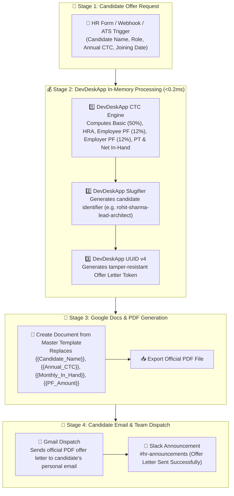

# 📄 Template #21594: Generate Indian CTC Offer Letters with DevDeskApp, Google Docs, Gmail and Slack

<div style="margin: 1rem 0; display: flex; gap: 8px; flex-wrap: wrap; align-items: center;">
  <span class="badge-live">Published on n8n.io Creator Portal</span>
  <span class="badge-live" style="background: rgba(16, 185, 129, 0.12); color: #10b981; border-color: rgba(16, 185, 129, 0.3);">Template ID: 21594</span>
</div>

🔗 **Direct n8n Template Link:**  
[https://n8n.io/workflows/21594-generate-indian-ctc-offer-letters-with-devdeskapp-google-docs-gmail-and-slack/)

<div class="doc-image">
  
</div>
<div class="doc-caption">Figure 1: Automated Indian CTC offer letter generation, PDF dispatch, and HR alert pipeline in n8n.</div>

---

## 🎯 Overview & Use Cases

Generating compensation offer letters manually is slow, error-prone, and fraught with compliance risks:

1. **Arithmetic & Formula Errors:** Statutory deductions under Indian Labor Law—such as Employee Provident Fund (12% of basic), Employer PF contribution (12%), and state Professional Tax (PT)—are frequently miscalculated in manual spreadsheets.
2. **Slow Candidate Experience:** Taking hours or days to draft custom offer agreements leads to lost engineering and executive hires.
3. **Data Security Concerns:** Uploading candidate compensation numbers to external cloud calculation services risks leaking sensitive HR figures.

**Template #21594** creates a fully automated, instant HR onboarding pipeline:
- Calculates accurate monthly gross, in-hand take-home, basic, HRA, employer/employee PF, and PT in **&lt; 0.2ms local execution**.
- Formats candidate filename slugs and generates unique RFC 4122 v4 offer reference tokens.
- Populates dynamic tags inside a master **Google Docs** offer template and exports an official signed PDF.
- Dispatches the PDF offer letter via **Gmail** to the candidate and posts an approval notification to your **HR Slack** channel.

---

## 📸 Workflow Architecture

### Pipeline Sequence



---

## ⚙️ Key Operations & Calculations

| Component | DevDeskApp Operation | Purpose |
| :--- | :--- | :--- |
| **CTC Salary Engine** | `ctc` | Automatically computes Indian statutory components: Basic salary, HRA, Employee PF, Employer PF, Professional Tax (PT), and monthly take-home. |
| **Slugifier** | `slugify` | Creates normalized, URL-safe candidate strings for file naming (e.g., `offer-rohit-sharma-2026.pdf`). |
| **UUID v4** | `generateUuid` | Injects an RFC 4122 v4 unique verification code for candidate tracking and electronic records. |

---

## ⚡ Real-Time Execution Sample

### Sample Candidate Input

```json
{
  "candidateName": "Aarav Sharma",
  "candidateEmail": "aarav.sharma@example.com",
  "designation": "Principal Backend Architect",
  "annualCtc": 2800000,
  "joiningDate": "2026-12-01"
}
```

### Generated Compensation Breakdown

```json
{
  "offerToken": "f784a91b-6f4e-4f38-89c5-8461019ad77c",
  "fileSlug": "aarav-sharma-principal-backend-architect",
  "payrollBreakdown": {
    "annualCtc": 2800000,
    "monthlyGross": 233333,
    "basicSalaryMonthly": 116666,
    "hraMonthly": 58333,
    "employeePfMonthly": 14000,
    "employerPfMonthly": 14000,
    "professionalTaxMonthly": 200,
    "netMonthlyTakeHome": 175133
  },
  "status": "OFFER_LETTER_GENERATED_AND_DISPATCHED"
}
```

---

## 📥 How to Import into Your n8n Instance

1. Open the [n8n Creator Portal page](https://n8n.io/workflows/21594-generate-indian-ctc-offer-letters-with-devdeskapp-google-docs-gmail-and-slack/) and click **"Use workflow"** or copy the JSON blueprint.
2. In your n8n workspace, navigate to **Workflows → New Workflow**.
3. Press **`Ctrl + V`** (or **`Cmd + V`** on macOS).
4. Connect your **Google Docs**, **Gmail**, and **Slack** credentials.
5. Save and execute to send your first automated offer letter!
