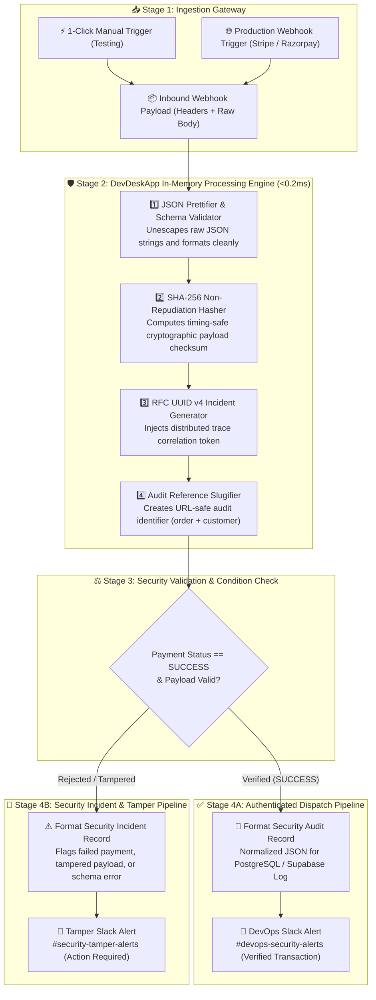

# 🛡️ Template #21376: Payment Webhook Sanitizer & Security Audit Pipeline

<div style="margin: 1rem 0; display: flex; gap: 8px; flex-wrap: wrap; align-items: center;">
  <span class="badge-live">Published on n8n.io Creator Portal</span>
  <span class="badge-live" style="background: rgba(245, 158, 11, 0.12); color: #f59e0b; border-color: rgba(245, 158, 11, 0.3);">Template ID: 21376</span>
</div>

🔗 **Direct n8n Template Link:**  
[n8n.io/workflows/21376](https://n8n.io/workflows/21376)

---

## 🎯 Overview & Use Cases

In modern production payment gateways (**Stripe**, **Razorpay**, **Lemon Squeezy**, **Shopify**, **PayPal**), incoming webhook events carry mission-critical financial data. However, engineering teams face significant architectural challenges:

1. **Unformatted & Minified Payloads:** Gateways often stream compact, escaped, or minified JSON strings that risk malformed parsing errors and crash downstream database ingest pipelines.
2. **Replay & Tampering Vulnerabilities:** Financial and order transactions require deterministic cryptographic **SHA-256 integrity digests** to guarantee non-repudiation and verify payload authenticity.
3. **Traceability Gaps Across Systems:** Without unified identifiers, debugging failed payment events across PostgreSQL, Slack alerts, and application logs is slow and fragmented.

**Template #21376** acts as an in-memory security and audit gateway. It intercepts incoming webhook payloads, validates and formats JSON, generates cryptographic checksums and UUID v4 correlation tokens, normalizes order slugs, and routes verified audit records to Slack and downstream databases—running **100% in local memory with zero external cloud API latency**.

---

## 📸 Workflow Architecture

<div class="doc-image">
  
</div>
<div class="doc-caption">Figure 1: Complete security audit and webhook sanitization canvas in n8n.</div>

### 🧩 Interactive Architecture & Multi-Stage Execution Flow



### 🔍 Execution Walkthrough (Step-by-Step):
- **Stage 1 (Dual Ingest):** Supports instant 1-click test runs via manual trigger or live production webhooks from payment gateways with zero configuration changes.
- **Stage 2 (Local In-Memory Security):** In sub-millisecond local Node.js cycles, DevDeskApp prettifies the payload, computes a SHA-256 cryptographic digest, assigns an RFC 4122 UUID v4 trace ID, and generates a unified audit slug.
- **Stage 3 (Zero-Trust Condition):** The `If` node evaluates payment capture status and integrity verification.
- **Stage 4 (Multi-Channel Routing):**
  - **Success Route:** Emits a compliant audit record and notifies `#devops-security-alerts`.
  - **Incident Route:** Catches tampered or failed transactions and triggers an immediate escalation to `#security-tamper-alerts`.

---

## ⚙️ Core Operations in Pipeline

| Node / Step | Tool / Operation | Purpose |
| :--- | :--- | :--- |
| **1. Webhook Ingest** | `manualTrigger` / `webhook` | Ingests live payment event headers and raw JSON body |
| **2. JSON Prettifier** | `devDeskApp` → `prettify` | Normalizes and validates raw/minified payload into structured JSON |
| **3. Integrity Hasher** | `devDeskApp` → `hash` (SHA-256) | Computes timing-safe SHA-256 cryptographic digest of payload |
| **4. Trace Token** | `devDeskApp` → `uuid` (v4) | Injects RFC 4122 UUID v4 incident identifier for distributed audit tracing |
| **5. Audit Slugifier** | `devDeskApp` → `slugify` | Generates clean URL-safe tracking slug from customer name and order ID |
| **6. Security Dispatch** | `code` + `slack` | Emits structured compliance payload and triggers real-time security alerts |

---

## ⚡ Consolidated Audit Output Sample

When executed, the workflow produces a structured, tamper-proof security record:

```json
{
  "auditRecord": {
    "traceId": "c47a2846-95e2-4bd1-bc91-236b3f7f02ea",
    "eventChecksum": "a79c4a8b753f19e782e4e135d0e729a4a753697e8838ec6f4bf4b74e64903e1a",
    "auditSlug": "priya-patel-ord-89421",
    "gatewayEvent": "payment.captured",
    "paymentId": "pay_N982kls823a",
    "orderId": "ORD-89421",
    "customer": {
      "name": "Priya Patel",
      "email": "priya.patel@example.com",
      "tier": "enterprise"
    },
    "amountFormatted": "₹4,999.00",
    "currency": "INR",
    "paymentMethod": "UPI",
    "status": "VERIFIED_SUCCESS",
    "processedAt": "2026-10-23T19:40:00.000Z"
  }
}
```

---

## 📥 How to Import into Your n8n Instance

1. Open the [official template page on n8n.io](https://n8n.io/workflows/21376).
2. Click **"Use workflow"** or copy the workflow JSON payload.
3. In your n8n workspace, navigate to **Workflows → New Workflow**.
4. Press **`Ctrl + V`** (or **`Cmd + V`** on Mac).
5. Configure the **Production Webhook Trigger** URL in your payment gateway dashboard (Stripe / Razorpay webhooks) and connect your Slack alerts channel!
